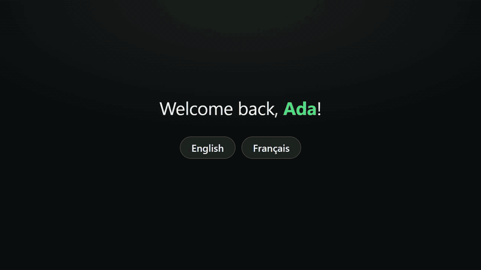
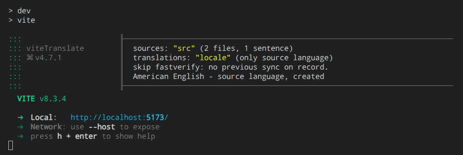
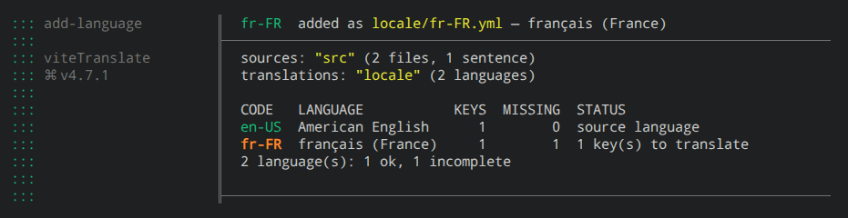
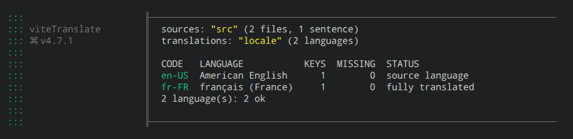

<div align="center">


**One toolchain. Every user's language.**

<!-- LINKED-DATA: this headline and the line below are the repo's pitch. The same pitch lives in two
     other places: the GitHub "About" text (gh api -X PATCH repos/sepoina/viteTranslate) and the
     `description` of package.json, which npm shows and rolldown.config.js copies into the dist
     banner. Change one, change all three. The headline is also the claim on the closing card of
     the GIF below (scene `pillars` in site/video/projects/gif20t/storyboard.md and .yaml) and on
     the GitHub social preview (doc/social/preview.html, shot to preview.png and uploaded by hand
     in the repo's Settings): VS Code, Vite, LLM and React come in the same order in all of them.
     Keywords are not the
     pitch's job: the 20 repository topics (gh api -X PUT repos/sepoina/viteTranslate/topics)
     carry i18next, react-i18next, vscode-extension, yaml, ssr and the rest of the search
     surface. -->

i18n for React, wired into the tools you already use: **VS Code** shows every marked string and its status, **Vite** extracts and syncs the YAML locales, an **LLM** of your choice translates what's missing, and **React** gets only the compiled build, 5 kB with zero runtime dependencies. Write the sentence in JSX: no keys to invent.

[](https://vite.dev)
[](https://www.npmjs.com/package/@sepoina/vitetranslate)
[](https://www.npmjs.com/package/@sepoina/vitetranslate)
[](#-why-vitetranslate)
[](https://marketplace.visualstudio.com/items?itemName=sepoina.vitetranslate-ide)
[](https://open-vsx.org/extension/sepoina/vitetranslate-ide)

[**Playground**](https://sepoina.github.io/viteTranslate/playground/) · [**Quick start**](#-quick-start) · [**VS Code**](#-vs-code-extension) · [**Guides**](#-guides)

<!-- LINKED-DATA: doc/workflow.gif is a copy of site/video/projects/gif20t/output/gif20t.gif (a campaign GIF, silent, looping). packages/idePlugin/README.md shows the same file, by absolute URL. Compose it again (node commons/cli/run.mjs gif20t compose, from site/video) and copy it over, and the README follows. -->


<!-- LINKED-DATA: same video id in site/landing/src/links.js (VIDEO_ID, the landing hero), packages/idePlugin/README.md, packages/launcher/README.md, the demo READMEs and the manual's overview (site/pages/docs/content/getting-started/overview.mdx). -->
<a href="https://youtu.be/gYj1z3XMv9M">▶ Watch the full video on YouTube</a>

</div>

<br /><br /><br />

## 🚀 Quick start

<!-- LINKED-DATA: steps 1-6 are also getting-started/installation and getting-started/usage in the manual (site/pages/docs/content), and demo/Vite_8/quickApp is the finished result. Change a step here, change the others. -->

### 1. Install and register the plugin

```sh
# New project? This creates the tree: Vite + React, JSX, no TypeScript
npm create vite@latest quickApp -- --template react --no-interactive && cd quickApp

npm install @sepoina/vitetranslate   # React 18/19 components & Vite 5–8 plugin
```

```js
// vite.config.js
import { defineConfig } from "vite";
import react from "@vitejs/plugin-react";
import { vitetranslate } from "@sepoina/vitetranslate";

export default defineConfig({
  plugins: [
    react(),
    vitetranslate({
      localeDir: "locale",
      sourceLanguage: "en-US",
    }),
  ],
});
```

### 2. Write text where it belongs

Wrap the app once:

```jsx
// src/main.jsx
import { TransContainer } from "@sepoina/vitetranslate/react";

<TransContainer initialLanguage="en-US">
  <App name="Ada" />
</TransContainer>
```

Then write sentences as they are, values and tags included:

```jsx
// src/App.jsx
import { Trans } from "@sepoina/vitetranslate/react";

export default function App({ name }) {
  return <Trans>Welcome back, <b>{name}</b>!</Trans>;
}
```

No key to invent, no duplicate string to maintain.

### 3. Start Vite: the source table writes itself

```sh
npm run dev
```



```yaml
# locale/en-US.yml
App_zn6492: "Welcome back, <b>{name}</b>!"
```

Keys are generated for you. The sync runs at every `vite dev` start and before every build: new keys in, stale ones out, and a string that moves keeps its translation.

### 4. Add a language

From a second terminal, the dev server can keep running:

```sh
npx vitetranslate --add fr-FR
```



```yaml
# locale/fr-FR.yml
App_zn6492: null
```

### 5. Translate

Replace each `null` by hand ([file format](https://sepoina.github.io/viteTranslate/docs/concepts/translation-files/)) or let an [LLM](#llm-auto-translation) do it:

```yaml
# locale/fr-FR.yml
App_zn6492: "Bon retour, <b>{name}</b> !"
```

Then check where you stand. `--status` writes nothing, so it doubles as a CI check:

```sh
npx vitetranslate --status
```



Until a key is translated the page shows the source text, never a blank. In dev, saving a table reloads the page.

### 6. Switch language and ship

```jsx
import { useTransLanguage } from "@sepoina/vitetranslate/react";

const { proposeNewLanguage } = useTransLanguage();
<button onClick={() => proposeNewLanguage({ lang: "fr-FR" })}>Français</button>
```

`npm run build`: each language compiles to its own chunk, loaded when selected ([React API](https://sepoina.github.io/viteTranslate/docs/hooks/use-translate-language/)).

<!-- LINKED-DATA: demo/Vite_8/quickApp is this quick start, finished; its card in site/landing/src/pages.js (DEMOS, slug vite8-quick-app) names the zip; site/video/projects/quickstart films it (storyboard.md, storyboard.yaml). Change a step here, change the demo too. -->
[**Download zip 🡭**](https://sepoina.github.io/viteTranslate/zip/demo/vite8-quick-app.zip) · [Open it on StackBlitz 🡭](https://stackblitz.com/github/sepoina/viteTranslate/tree/main/demo/Vite_8/quickApp?file=src/App.jsx) · [**Read React API 🡭**](https://sepoina.github.io/viteTranslate/docs/components/translate-container/)

<details>
<summary>🡷 <b>Next steps: plain strings, short names, plurals and dates</b></summary>

<br />

**Plain strings** — attributes, titles, anything that isn't JSX — go through `` trans`…` ``. Live in the [playground](https://sepoina.github.io/viteTranslate/playground/):

```jsx
import { Trans, useTrans } from "@sepoina/vitetranslate/react";

function App({ name }) {
  const trans = useTrans();
  return (
    <>
      <Trans>Nice to meet you, <b>{name}</b></Trans>
      <input placeholder={trans`Write to ${name}`} />
    </>
  );
}
```

`Trans`, `useTrans`, `TransContainer`, `useTransLanguage` are the short names of `Translate`, `useTranslateToString`, `TranslateContainer`, `useTranslateLanguage`: same functions, both work.

**Plurals and dates** go in a string marked `_%_…_%_`: see **[ICU messages](https://sepoina.github.io/viteTranslate/docs/concepts/icu/)**. Prefer other delimiters? `markerStart`/`markerEnd` — see [plugin options](https://sepoina.github.io/viteTranslate/docs/concepts/markers/).

</details>

<details>
<summary>🡷 <b>CLI commands: sync, add languages, CI check, LLM</b></summary>

<br />

Run `npx vitetranslate` from the project root. Tired of `npx`? This installs a tiny [launcher](packages/launcher#readme) that runs each project's own version:

```sh
npm i -g vitetranslate
```

| Command | Does |
| :- | :- |
| `vitetranslate` | Full sync: new keys in, stale ones out, renamed strings keep their translation |
| `vitetranslate --add fr-FR de-DE` | Adds languages, each file listing every key with `null` to fill |
| `vitetranslate --status` | Reports every table and writes nothing. Exits `1` on errors only, so it works as a CI check |
| `vitetranslate --llm-translate` | Fills the `null` keys through an LLM — see [below](#llm-auto-translation) |

Full reference: **[CLI reference](https://sepoina.github.io/viteTranslate/docs/api/cli/)**.

</details>

<br /><br />

## 🔖 What you get

- **Less manual work.** Extraction and sync run inside Vite, not as a separate command to remember.

- **A lightweight runtime.** 5 kB gzip, no extra runtime dependencies, and no message parsing at runtime.

- **Tools where you need them.** A CLI for sync, CI checks and guarded LLM translation; a VS Code extension showing every string and its status.

- **Ready for real interfaces.** [ICU](https://sepoina.github.io/viteTranslate/docs/concepts/icu/) plurals, select, numbers and dates; lazy-loaded locales; the source text as fallback until translated; a safe subset of HTML tags.

<br /><br />

## 🔮 VS Code extension

Every marked string with its translation status, locale files opened at the key, Sync and LLM one click away.

[**Install from the Marketplace 🡭**](https://marketplace.visualstudio.com/items?itemName=sepoina.vitetranslate-ide) · [**Open VSX 🡭**](https://open-vsx.org/extension/sepoina/vitetranslate-ide) (Cursor, Windsurf, VSCodium) · [Extension guide 🡭](https://sepoina.github.io/viteTranslate/docs/vscode/panel/)

<br /><br />

## 📟 LLM auto-translation

`npx vitetranslate --llm-translate` fills missing entries through any OpenAI-compatible API or your own driver. It prints the cost first, respects your budget, validates every result before writing, and never runs during `vite dev`.

[**LLM guide 🡭**](https://sepoina.github.io/viteTranslate/docs/llm/setup/) · [**Translated restaurant demo 🡭**](https://sepoina.github.io/viteTranslate/llmrestaurant/)

<br /><br />

## ⚡ Why viteTranslate

<!-- LINKED-DATA: site/landing/src/Compare.jsx (ROWS) shows these rows too, License excluded. A mark changed here changes there, with its note below and the date. Feature links point to viteTranslate's own guide for that row: same targets as `doc` there, and its en-US labels (site/landing/locale/en-US.yml) use these words. Order, same there: columns viteTranslate, Lingui, FormatJS, i18next; rows first where no rival has ✅, then where one matches it, each group from the widest lead (rivals' ❌ = 0, 🟡 = ½, ✅ = 1, summed) to the narrowest (ties: fewer rivals at ✅ first), License last. -->

| Feature | viteTranslate | Lingui | FormatJS | i18next |
| :- | :-: | :-: | :-: | :-: |
| [Extraction inside the Vite lifecycle](doc/structure.md#auto-sync-at-config-time) ¹ | ✅ | ❌ | ❌ | ❌ |
| [Zero runtime dependencies](https://sepoina.github.io/viteTranslate/docs/getting-started/installation/#it-never-reaches-your-bundle) | ✅ | ❌ | ❌ | ❌ |
| [Official VS Code extension](https://sepoina.github.io/viteTranslate/docs/vscode/install/) | ✅ | ❌ | ❌ | ❌ |
| [LLM auto-translation](https://sepoina.github.io/viteTranslate/docs/llm/setup/) ² | ✅ | ❌ | ❌ | 🟡 |
| [No message parsing at runtime](doc/structure.md#2b-table-compilation-pre-building-values) ³ | ✅ | 🟡 | 🟡 | ❌ |
| [Tiny runtime (<6 kB gzip)](doc/structure.md#phase-4--runtime-the-resolution-chain) ⁴ | ✅ | ✅ | ❌ | ❌ |
| [Keyless / Natural text syntax](https://sepoina.github.io/viteTranslate/docs/components/translate/#write-jsx-inside-translate) ⁵ | ✅ | ✅ | 🟡 | 🟡 |
| [Official Vite plugin](https://sepoina.github.io/viteTranslate/docs/api/plugin-options/) | ✅ | ✅ | ✅ | ❌ |
| [ICU MessageFormat (plurals, select, dates)](https://sepoina.github.io/viteTranslate/docs/concepts/icu/) | ✅ | ✅ | ✅ | 🟡 |
| [Lazy-loaded locales](https://sepoina.github.io/viteTranslate/docs/concepts/preloading/) | ✅ | ✅ | ✅ | ✅ |
| [License](LICENSE) | Apache-2.0 | MIT | BSD-3-Clause | MIT |

<small>✅ native support · 🟡 partial support, official add-on or extra setup · ❌ not offered by the project. <br />Documentation checked on October 10, 2026: Lingui 6, FormatJS (react-intl 12), i18next 26 + react-i18next 17.</small>

<details>
<summary>
🡷 <b>Notes on the comparison, and what each feature buys you</b>
</summary>

<br />

- **How to read it:** a ❌ means the project's own tooling doesn't offer it — a third-party tool may still fill the gap. Native support does not mean zero configuration: lazy loading still needs application code in the other libraries. The comparison covers the React integrations.
- **¹ Extraction inside the Vite lifecycle:** the plugin extracts the markers and syncs one YAML table per language by itself — a quick check when `vite dev` starts, a full scan before every build. Missing keys added, stale ones removed, the rest reported; a string that moved keeps its translation. 🎮 [Live](https://sepoina.github.io/viteTranslate/playground/#install-sync). The others extract with a separate command: `i18next-cli extract` and `lingui extract` (both with a `--watch` mode) sync every language file; `formatjs extract` writes the source language only, the rest comes from your TMS.
- **Zero runtime dependencies:** none declared, and not on trust: the test suite asserts that the browser runtime imports nothing beyond React and the virtual module. `@babel/core` and Vite are _peer_ dependencies: they run the plugin on your machine and never enter the bundle. React is the one your app already ships. For comparison, `react-i18next` depends on three packages (i18next core on none), `@lingui/react` on `use-sync-external-store` plus Lingui's own packages, `react-intl` on three FormatJS packages.
- **Official VS Code extension:** [viteTranslate's](#vs-code-extension) lists every marked string with its translation status, opens the language file right on the key, runs Sync and the LLM in one click, and highlights marked strings as you type. It asks the library installed in your project, so the panel and the CLI never disagree. Still in preview. No extension maintained by the other projects was found in the official resources checked: i18next and react-intl rely on third-party extensions, such as Lokalise's [i18n Ally](https://marketplace.visualstudio.com/items?itemName=lokalise.i18n-ally) or inlang's [Sherlock](https://marketplace.visualstudio.com/items?itemName=inlang.vs-code-extension) (i18next only); neither lists Lingui among its supported libraries.
- **² LLM auto-translation:** `npx vitetranslate --llm-translate` fills the untranslated keys through the model you configure — any OpenAI-compatible API, or your own driver. It prints the cost first, asks before spending, and a validator refuses anything that would break at runtime (lost `%s`, mangled tags). See [the LLM guide](https://sepoina.github.io/viteTranslate/docs/llm/setup/), 🎮 [the walkthrough](https://sepoina.github.io/viteTranslate/playground/#install-llm), or [the restaurant](https://sepoina.github.io/viteTranslate/llmrestaurant/) it translated. The i18next team offers AI translation through Locize, its paid hosted service, wired into [`i18next-cli`](https://github.com/i18next/i18next-cli). Lingui has an [open RFC](https://github.com/lingui/js-lingui/discussions/2392) and community tools; FormatJS leaves translation to your TMS.
- **³ No message parsing at runtime:** tables are compiled at build time into ready-made values. In a production build `<Translate>` parses nothing, neither ICU nor HTML — which is also why it renders server-side. Lingui precompiles ICU, but splits the `<0>…</0>` component tags of the translated string at render time through [`formatElements`](https://github.com/lingui/js-lingui/blob/main/packages/react/src/TransNoContext.tsx). Its 🟡 means partial support: ICU is precompiled, rich-text tags are still processed. FormatJS [avoids runtime parsing](https://formatjs.github.io/docs/guides/advanced-usage/) when all messages and `defaultMessage`s are precompiled; the `no-parser` alias separately removes the parser code from the bundle. i18next interpolates at runtime, and `i18next-icu` parses there too.
- **⁴ Runtime size:** viteTranslate's browser runtime weighs 5.8 kB gzip (1 kB = 1024 bytes) — `6036 bytes` exactly: 4838 B for the React runtime plus 1198 B for the ICU helpers, which ship only when a table uses ICU. Measured by `npm run estimateSize`, the source of truth for this number, on the whole API. The historical local measurements for the others (not independently reverified in the October documentation check), with the same tools (rolldown, minified, gzip, React left out) on what a basic app imports — provider, component, hook — in September 2026: Lingui 3 kB (smaller, yes), react-intl 13 kB (6 kB with its `no-parser` alias), i18next + react-i18next 19 kB. Imports, plugins and polyfills move every figure: read them as orders of magnitude.
- **⁵ Keyless syntax:** the sentence you write in JSX is the source — values, tags and links included — and its key is generated at build time and resolved against the current table at runtime: no key to invent, nothing to keep in sync by hand. 🎮 [Live](https://sepoina.github.io/viteTranslate/playground/#static-text). Lingui does the same with its macros; FormatJS [generates IDs and discourages manual IDs](https://formatjs.github.io/docs/getting-started/message-extraction/); its 🟡 refers to configuring the build transform, not to missing keyless support. i18next can use the sentence as the key (`keySeparator: false`, `nsSeparator: false`): possible, say its docs, but not recommended.
- **Official Vite plugin:** viteTranslate's does the whole job — extraction, sync, compilation, one chunk per language — with the same code from Vite 5 to 8. Lingui's [`@lingui/vite-plugin`](https://lingui.dev/ref/vite-plugin) compiles catalogs and can transform macros with `macroTransform: true`, without a separate Babel or SWC plugin; FormatJS's [`@formatjs/unplugin`](https://formatjs.github.io/docs/tooling/unplugin/) generates IDs and pre-parses messages. i18next has none, and needs none: there is nothing to compile.
- **ICU MessageFormat:** plurals, `select`, numbers and dates — compiled at build time, same as everything else. One deliberate deviation: an apostrophe is always an apostrophe, never ICU quoting. i18next has its own plural and context syntax built in; ICU needs the official [`i18next-icu`](https://github.com/i18next/i18next-icu) plugin. See [the ICU guide](https://sepoina.github.io/viteTranslate/docs/concepts/icu/) — 🎮 [plurals](https://sepoina.github.io/viteTranslate/playground/#icu-plural), [select](https://sepoina.github.io/viteTranslate/playground/#icu-select), [dates](https://sepoina.github.io/viteTranslate/playground/#icu-format), 🧪 [edge cases](https://sepoina.github.io/viteTranslate/edge/#icu).
- **Lazy-loaded locales:** each language is its own chunk, `import()`-ed only when selected — no loader to write. 🎮 [Live](https://sepoina.github.io/viteTranslate/playground/#language-switch). The others load catalogs through their API, from an `import()` you write, or a backend plugin for i18next.
- **Dev fallback, always visible:** until a translation exists you get the original text. Never a blank, never a crash — and a [mark](https://sepoina.github.io/viteTranslate/docs/concepts/diagnostics/) says so, in development only.
- **Small, safe HTML subset:** `<b> <strong> <i> <em> <u> <small> <code> <br> <hr> <wbr>` and nothing else. Everything outside it is unwrapped to plain text, and no attribute is ever forwarded. 🎮 [Live](https://sepoina.github.io/viteTranslate/playground/#markup), 🧪 [broken markup included](https://sepoina.github.io/viteTranslate/edge/#html).

</details>

<br /><br />

## 📚 Guides

 - **[The manual](https://sepoina.github.io/viteTranslate/docs/)** — start here: overview, tutorials, every reference
 - **[CLI](https://sepoina.github.io/viteTranslate/docs/api/cli/)** — sync, `--add`, `--status` as a CI check, and what to do when the sync stops
 - **[React API](https://sepoina.github.io/viteTranslate/docs/components/translate-container/)** — every component and hook, language switching, preloading
 - **[Plugin options](https://sepoina.github.io/viteTranslate/docs/api/plugin-options/)** — everything `vitetranslate()` accepts: folders, auto-sync, markers, diagnostics
 - **[LLM translation](https://sepoina.github.io/viteTranslate/docs/llm/setup/)** — fill the `null`s with any OpenAI-compatible model, on a budget, validated
 - **[ICU messages](https://sepoina.github.io/viteTranslate/docs/concepts/icu/)** — plurals, select, numbers and dates, compiled at build time
 - **[Translation file format](https://sepoina.github.io/viteTranslate/docs/concepts/translation-files/)** — what's inside `locale/*.yml`, and how to add a language
 - **[VS Code panel](https://sepoina.github.io/viteTranslate/docs/vscode/panel/)** — every string and its status, tables opened at the key, Sync and LLM in one click

 More: [Architecture](doc/structure.md) · [Known limitations](https://sepoina.github.io/viteTranslate/docs/concepts/limitations/) · [Requirements](https://sepoina.github.io/viteTranslate/docs/getting-started/installation/) · [Live examples](https://sepoina.github.io/viteTranslate/docs/getting-started/live-examples/)

<br /><br />

 ## 🎐 Links 

 [Live site](https://sepoina.github.io/viteTranslate/) · [Discussions](https://github.com/sepoina/viteTranslate/discussions) · [Issues](https://github.com/sepoina/viteTranslate/issues) · [Contributing](CONTRIBUTING.md) · [Provenance](https://docs.npmjs.com/trusted-publishers/) · [Apache-2.0 license](LICENSE)

<br /><br />

☕ [PayPal](https://www.paypal.com/paypalme/giancarloghigi) · [Buy Me a Coffee](https://www.buymeacoffee.com/giancarlogy)
if it saved you a few translation keys.
